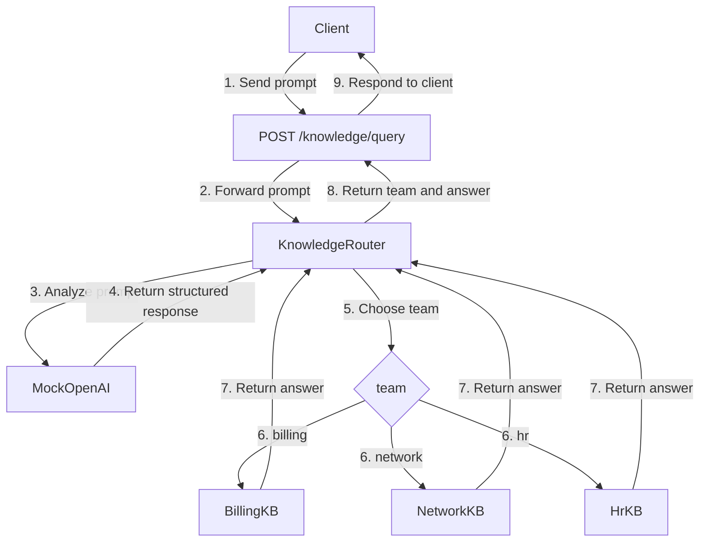

# Knowledge base mapping



The client sends a prompt to `POST /knowledge/query`, for example "Why was last month's invoice higher than usual?". The router asks MockOpenAI which team the prompt belongs to. MockOpenAI returns a structured response:

```json
{
  "team": "billing",
  "confidence": 0.9,
  "reasoning": "The prompt mentions invoice."
}
```

That team selects Billing, Network, or HR. Each base is an AI with a vector database. The prompt queries that database, and the AI answers from the retrieved data. For this prompt, BillingKB returns:

```text
Last month's invoice was higher because a usage overage of $120 was added on the 14th.
```

The API sends that answer and the team back to the client.

## Traceability

Every request that arrives gets a unique id, for example `req_8f3a1c`. That id is returned to the client and written on each log for the request: classification, the team that was chosen, and the knowledge-base call. The same id ties those steps together.

## Error handling

If the request to MockOpenAI or a knowledge base fails or times out, it is retried three times. If it still fails, the API returns:

```json
{
  "code": "ai_request_failed",
  "message": "The AI request failed after 3 retries."
}
```

## Scaling

Each knowledge base can move to its own microservice. The router still chooses the team and calls that service. Resources can then scale for the microservice that has the most demand, leaving the least-demand microservices operating on the least resources.

## Kubernetes and Docker

Docker packages each service as a container. Kubernetes manages those containers. It handles deployments and keeps the system live. If something crashes, Kubernetes brings it back up automatically.
